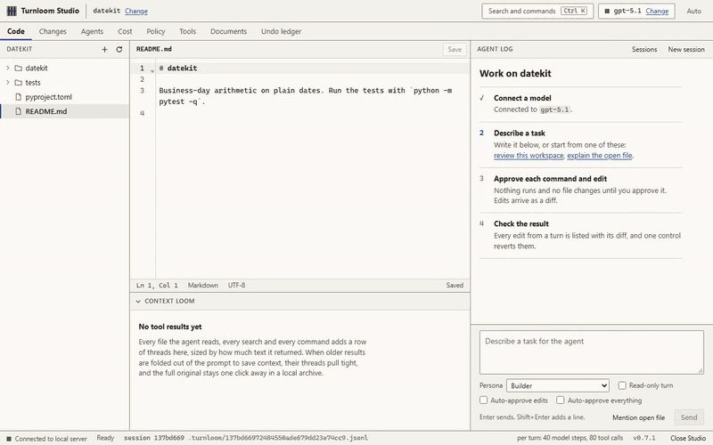

[](https://pypi.org/project/turnloom/) [](https://pypi.org/project/turnloom/) [](https://github.com/bhaskargurram-ai/turnloom/actions/workflows/test.yml) [](https://github.com/bhaskargurram-ai/turnloom/blob/main/LICENSE) [](https://github.com/bhaskargurram-ai/turnloom/issues?q=is%3Aissue+is%3Aopen+label%3A%22good+first+issue%22)

Turnloom is a coding agent for your terminal and desktop that shows you what it keeps in context and what each call costs. It reads and edits files, runs commands with your approval, and folds older tool output out of the prompt into a local archive that you and the model can read back at any time. Every edit is shown as a diff before it lands and can be undone afterwards. Every model call is metered.

It works with any OpenAI-compatible endpoint: hosted providers, OpenRouter, or a model on your own machine through Ollama, LM Studio, vLLM or llama.cpp. LiteLLM adds Anthropic, Bedrock, Vertex AI and Azure.

[Quick start](#quick-start) · [Examples](#examples) · [Studio](#studio) · [Staying in control](#staying-in-control) · [How context works](#how-context-works) · [Benchmarks](#benchmarks) · [Works with](#works-with) · [Docs](#documentation) · [Contributing](#contributing)



*A real session, sped up: `gpt-5.1` fixes a failing test in Studio. Each command and the edit wait for approval, and the Context Loom at the bottom shows what was folded out of the prompt.*

## Why Turnloom

- **You can see the context.** Long tool output is folded out of the prompt, not summarised away. The original stays in a local archive, the model reads it back with `recall`, and you can open the same reference yourself.
- **You stay in control.** Commands, edits and MCP calls wait for your approval. Edits arrive as diffs, and `turnloom undo` takes a turn's edits back, even from a later session.
- **You know what it cost.** Each run ends with a receipt: input, output and cached tokens, characters folded, files changed and the estimated cost. A budget stops a task before it overspends.
- **It is small and yours.** One loop and a handful of tools on the Python standard library plus one dependency. No account, no telemetry, no background service. MIT licensed.

## Quick start

Turnloom needs Python 3.11 or newer.

```sh
pipx install turnloom      # or: uv tool install turnloom, or: pip install turnloom
turnloom connect           # pick a provider and a model; the key goes to your OS credential store
turnloom run "The tests in test_slugify.py fail. Fix slugify.py so they pass without changing the tests. Check with: python -m unittest -q test_slugify" --auto-edit --allow "python*" --effort low
```

That last command, run in [`examples/tasks/slugify`](https://github.com/bhaskargurram-ai/turnloom/tree/main/examples/tasks/slugify) with gpt-5.1, printed this:

```text
Turnloom 0.7.0  ·  builder  ·  gpt-5.1  ·  ask before acting  ·  session caaa5b10
  → list_files .
  ← done (0.0s)
  → read_file slugify.py
  ← done (0.0s)
  → read_file test_slugify.py
  ← done (0.0s)
  → edit_file slugify.py
  ← +3 −1 (0.0s)
  → shell python -m unittest -q test_slugify
  ← exit 0 (0.4s)
Changes made:
- Updated `slugify` in `slugify.py` to normalize the input string to lowercase before extracting word characters:
  - Before: `re.findall(r"[a-z0-9]+", title)`
  - After: `re.findall(r"[a-z0-9]+", title.lower())`
- Added a brief comment explaining the need for lowercasing.

Checks run:
- `python -m unittest -q test_slugify`

All tests now pass. No further issues detected.

completed  ·  6,523 input / 802 output tokens (2,816 cached)  ·  0 context characters folded  ·  1 file changed  ·  estimated $0.016174
```

Without `--auto-edit` and `--allow`, Turnloom stops at each edit and each command, shows you the diff or the command line, and waits for `y`, `n` or `a` (always, for this session). `turnloom undo` restores the file. `turnloom chat` does the same work across several turns.

No API key? `turnloom connect ollama` uses a model on your machine, and `turnloom connect openrouter --tier free` signs in through your browser and lists the free models. `turnloom doctor` checks the setup. More in the [quick start guide](https://github.com/bhaskargurram-ai/turnloom/blob/main/docs/quickstart.md) and the [provider guide](https://github.com/bhaskargurram-ai/turnloom/blob/main/docs/providers.md).

Other ways to install: `uvx turnloom chat` runs it without installing, `docker run ghcr.io/bhaskargurram-ai/turnloom` runs it in a container, and on Windows you can clone the repository and double-click **Open Turnloom Studio.cmd**, which creates its own environment.

## Examples

Each of these is a complete command. The [recipes](https://github.com/bhaskargurram-ai/turnloom/blob/main/docs/recipes.md) explain them and the [command reference](https://github.com/bhaskargurram-ai/turnloom/blob/main/docs/cli.md) lists every flag.

**Review code without touching it.** A read-only session has no edit, shell or MCP tools, so it reads files, not Git history.

```sh
turnloom run "Review the code under src/ for bugs. Report the three most important." --persona reviewer --read-only
```

**Work in a conversation, then pick it up tomorrow.**

```sh
turnloom chat                 # /diff, /undo, /new and /help work inside
turnloom chat --resume        # continue the most recent session with its tool results intact
turnloom sessions             # list saved sessions; --resume ID picks one
```

**Cap what a task may spend.**

```sh
turnloom run "Migrate the config loader to tomllib" --budget 0.50 --max-steps 60
```

**Plan, build and review in stages.** The planning and review stages cannot edit; all three share one budget.

```sh
turnloom team "Add input validation to the signup form"
```

**Use a local model.** Nothing leaves your machine.

```sh
ollama pull qwen2.5-coder
turnloom connect ollama
turnloom chat
```

**Run unattended in a container.** `--yes` approves everything, so it belongs in a sandbox.

```sh
docker run --rm -it -v "$PWD:/workspace" \
  -e TURNLOOM_ENDPOINT -e TURNLOOM_MODEL -e TURNLOOM_API_KEY \
  ghcr.io/bhaskargurram-ai/turnloom run "Fix the failing test" --yes
```

**Review every pull request in CI.**

```yaml
- uses: actions/checkout@v7
- uses: bhaskargurram-ai/turnloom@v0.7.1
  with:
    task: Review the code under src/ for bugs and report the three most important findings.
    persona: reviewer
    mode: read-only
    endpoint: https://openrouter.ai/api/v1
    model: ${{ vars.TURNLOOM_MODEL }}
    api-key: ${{ secrets.OPENROUTER_API_KEY }}
```

**Give the agent MCP tools.** It searches a server's tools and calls them with your approval.

```sh
pipx install "turnloom[mcp]"
turnloom tools examples/mcp.json git git_status     # inspect a server without a model
turnloom chat --mcp examples/mcp.json
```

**Drive it from your editor.** `turnloom acp` speaks the Agent Client Protocol. In Zed's `settings.json`:

```json
{ "agent_servers": { "Turnloom": { "type": "custom", "command": "turnloom", "args": ["acp"], "env": {} } } }
```

**Let another agent delegate to it.** `turnloom serve` is an MCP server that any MCP client can start; with `--allow-run` it accepts tasks.

```sh
turnloom serve --allow-run          # add --allow-edits and --allow-shell to let delegated tasks change things
```

**Call it from Python.**

```python
from pathlib import Path
from turnloom import providers
from turnloom.agent import Config, run_agent

connection = providers.resolve()                      # the model saved by `turnloom connect`
config = Config(connection.endpoint, connection.model, connection.key, Path.cwd(), read_only=True)
result = run_agent("In one sentence, what does this project do?", config)
print(result.status, result.answer, result.usage)
```

## Studio

```sh
pipx install "turnloom[studio]"
turnloom studio
```

Studio is a workbench that opens in its own window, or in a browser tab with `--browser`. The base install runs it too; the `studio` extra adds the native window, the policy gate, exact token counts and document tools.


| View | Use it to |
| --- | --- |
| **Code** | Edit files beside the agent's work log. The reply streams in, each tool call shows what ran, and edits arrive as diffs to approve, reject, or allow for the session. After a turn, review every file it touched and revert the turn's edits. |
| **Context Loom**, inside Code | See each tool result's original size and what the prompt still carries. Open any folded result to read the archived original without spending a model call. |
| **Changes** | Compare the working tree with the last commit. |
| **Agents** | Pick from 285 personas, or line several up as a team that plans, builds and reviews in stages. |
| **Cost** | See tokens and estimated cost per call, how full the context window is and what fills it, and set a budget per turn. |
| **Policy** | Gate every tool call with Provio: what was allowed, asked and denied, a tester for a command or path, and the ledger's integrity. |
| **Tools** | Turn MCP servers on for the agent and inspect the tools each one offers. |
| **Documents** | Extract fields from a document with VerifyDoc and see each value's confidence and where it was read. |
| **Undo ledger** | Review what Unwind recorded for MCP calls, set checkpoints and take actions back. |

Sessions are saved in the workspace; start a new one or resume an earlier one. Press **Ctrl+K** for the command palette.

Studio listens on 127.0.0.1 only and requires a per-launch token on every request. Details are in [SECURITY.md](https://github.com/bhaskargurram-ai/turnloom/blob/main/SECURITY.md). To ship it as a standalone app folder, see [Desktop app](https://github.com/bhaskargurram-ai/turnloom/blob/main/docs/desktop.md).

## Staying in control

Turnloom asks before it runs a command, edits a file or calls an MCP tool. Reading and searching files inside the workspace does not need approval, and those reads are sent to the model you connected.

| Mode | Flag | Behavior |
| --- | --- | --- |
| Ask (default) | none | Approve each command and edit. Answer `a` to allow all later edits, or that exact command, for the session. |
| Auto-edit | `--auto-edit` | Edits apply without asking. Commands still ask. |
| Allowlist | `--allow "pytest*"` | Simple commands matching the pattern run without asking. A pattern never covers a command that chains, pipes, redirects or substitutes. |
| Read-only | `--read-only` | No edits and no shell. The agent can only read, search and answer. |
| Unattended | `--yes` | Everything is approved. Use it only inside a container or a disposable checkout. |

Other limits you can set per task: `--budget 0.25` stops before the estimated cost passes that amount, `--max-steps` caps model calls (100 by default), and `--deadline` caps wall time. At the step limit the agent spends its last call writing up what it found. Three identical tool calls in a row end tool use the same way. The other limits stop the turn and say why.

Commands run with your user's permissions. Model API keys are removed from the environment that commands see. Files that usually hold secrets, such as `.env`, private keys and credential files, are closed to the file tools. The file tools reach only the workspace; anything outside it goes through a shell command you approve.

### A policy under the agent

[Provio](https://github.com/writ-agent/provio) checks each tool call against a `provio.yaml` in your repository before it runs, and writes every decision to a hash-chained ledger at `.provio/ledger.jsonl`. Turnloom turns the gate on whenever the workspace has that file and the `guard` extra is installed. Create a starter policy from Studio's Policy view or with `provio init`.

| Verdict | What happens |
| --- | --- |
| deny | The tool does not run. The model reads the rule and its reason, so it can correct course. |
| ask | You decide this call, and the question names the rule that asked. `--auto-edit`, allow patterns and an earlier "always" do not answer for you. With `--yes` there is nobody to ask, so the call is refused. |
| allow | The call runs. By default you still confirm each call; in Studio choose the policy mode to be asked only when a rule says ask. |
| redact | The call runs and the model receives Provio's redacted output. |

The gate covers shell commands, file reads, file edits and MCP tool calls, and it fails closed: if Provio cannot answer, the tool does not run. Pass `--no-gate` to run once without the policy.

## How context works

Long sessions fill the prompt with old tool output. Turnloom handles that without a summarizing model call:

1. **Fold.** The three most recent tool results stay whole. Older results of 4,000 characters or more are replaced in the prompt by a short preview of their start and end and a reference. Results the model has not read yet are never folded.
2. **Archive.** The full text stays in the session's archive. When a command prints more than fits, the prompt gets the head and tail and the archive keeps the rest.
3. **Recall.** The model calls `recall` with a reference to read a slice or search inside an archived result. You can open the same reference in Studio.
4. **Overflow.** If the conversation still outgrows the model's window, the oldest exchanges move to the archive as a unit and their references are listed for the model. Nothing is dropped without a way back.

The transcript of every session is a JSON Lines file under `.turnloom/` in the workspace, with a `.gitignore` that keeps traces out of version control. `--resume` rebuilds the conversation and its archive from that file. Studio and the proxy also append every model call to `.turnloom/usage.jsonl`.

Use `--no-fold` to compare a run with folding against one without. Folding rewrites earlier messages, so on providers with prompt caching it trades some cache hits for a smaller prompt. Measure on your own tasks before relying on it. [Design notes](https://github.com/bhaskargurram-ai/turnloom/blob/main/docs/design.md) · [Measuring it yourself](https://github.com/bhaskargurram-ai/turnloom/blob/main/docs/experiments.md)

## Benchmarks

Turnloom and seven other agents were given the same 19 [Terminal-Bench 2.1](https://github.com/harbor-framework/terminal-bench-2-1) tasks, the same model (`gpt-5.1`) and one attempt per task, with every model call metered the same way.


- **Tasks solved:** Turnloom 10 of 19. The best agents solved 11, and six of the eight agents landed between 9 and 11. With 19 tasks that is a tie.
- **Cost:** 0.160 USD per task, in the middle. OpenCode and Goose were cheaper at 0.091 and 0.101.
- **Tokens:** Turnloom sent 70,000 input tokens per task, where five of the other agents sent between 110,000 and 327,000. It produced more output tokens than the cheapest agents, and output is where its cost went.

This is a small sample, run once, by Turnloom's author. The run also found three problems in Turnloom, which 0.7.1 fixes. [Method, per-task results, limits and the scripts to repeat it](https://github.com/bhaskargurram-ai/turnloom/blob/main/benchmarks/README.md).

## Works with

| You have | Turnloom does | How |
| --- | --- | --- |
| An `AGENTS.md` or `CLAUDE.md` | Adds it to the agent's instructions | Nothing to configure |
| Agent Skills in `.agents/skills` or `.claude/skills` | Lists them for the model, which reads one when a task calls for it | Nothing to configure |
| A specialist in mind | 285 personas: Builder and Debugger are Turnloom's own, 283 come from [Agency Agents](https://github.com/msitarzewski/agency-agents) at commit `8ae6164` | `--persona ID`, or your own Markdown in `.turnloom/personas/` |
| MCP servers | Connects stdio and streamable HTTP servers; calls need your approval | `--mcp servers.json`, or `.turnloom/mcp.json` in Studio |
| Another agent | Serves receipts, archived tool output and, with `--allow-run`, task delegation over MCP | `turnloom serve` |
| Another harness | Folds and meters its requests through an OpenAI-compatible endpoint | `turnloom proxy` |
| An editor that speaks ACP (Zed, JetBrains) | Runs as its agent | `turnloom acp` |
| A provider that is not OpenAI-compatible | Reaches it through [LiteLLM](https://github.com/BerriAI/litellm) | `turnloom connect litellm:anthropic` with the `llm` extra |
| GitHub Actions or a container | Runs one task and reports the result | `uses: bhaskargurram-ai/turnloom@v0.7.1`, `ghcr.io/bhaskargurram-ai/turnloom` |
| Documents and MCP side effects | Scores extracted fields with [VerifyDoc](https://github.com/bhaskargurram-ai/verifydoc); classifies and reverses MCP calls with [Unwind](https://github.com/bhaskargurram-ai/unwind) | The `documents` extra |
| A benchmark harness | Runs headless with a [Harbor](https://github.com/harbor-framework/harbor) adapter and ATIF export | `turnloom-agent` |

Each of these is described with a working example in the [integration guide](https://github.com/bhaskargurram-ai/turnloom/blob/main/docs/integrations.md).

## What Turnloom is not

It is a small agent: one loop, a handful of tools, no background services and no telemetry. It does not sandbox commands at the operating system level or index your repository. If you need isolation, run it in the provided container.

## Documentation

| Start here | Use | Extend and measure |
| --- | --- | --- |
| [Quick start](https://github.com/bhaskargurram-ai/turnloom/blob/main/docs/quickstart.md) | [Command reference](https://github.com/bhaskargurram-ai/turnloom/blob/main/docs/cli.md) | [Integrations: MCP, skills, proxy, CI, containers](https://github.com/bhaskargurram-ai/turnloom/blob/main/docs/integrations.md) |
| [Recipes](https://github.com/bhaskargurram-ai/turnloom/blob/main/docs/recipes.md) | [Configuration: files and environment](https://github.com/bhaskargurram-ai/turnloom/blob/main/docs/configuration.md) | [Design: the loop and the context store](https://github.com/bhaskargurram-ai/turnloom/blob/main/docs/design.md) |
| [FAQ and troubleshooting](https://github.com/bhaskargurram-ai/turnloom/blob/main/docs/faq.md) | [Providers, models and credentials](https://github.com/bhaskargurram-ai/turnloom/blob/main/docs/providers.md) | [Experiments: comparing two configurations](https://github.com/bhaskargurram-ai/turnloom/blob/main/docs/experiments.md) |
| [Security model](https://github.com/bhaskargurram-ai/turnloom/blob/main/SECURITY.md) | [Desktop app](https://github.com/bhaskargurram-ai/turnloom/blob/main/docs/desktop.md) | [Benchmarks](https://github.com/bhaskargurram-ai/turnloom/blob/main/benchmarks/README.md) and [leaderboard status](https://github.com/bhaskargurram-ai/turnloom/blob/main/docs/leaderboard.md) |

[Changelog](https://github.com/bhaskargurram-ai/turnloom/blob/main/CHANGELOG.md) · [Roadmap](https://github.com/bhaskargurram-ai/turnloom/blob/main/ROADMAP.md) · [All documentation](https://github.com/bhaskargurram-ai/turnloom/blob/main/docs/README.md)

## Contributing

Turnloom is small enough to read in an afternoon, and it is looking for people to improve it. The [roadmap](https://github.com/bhaskargurram-ai/turnloom/blob/main/ROADMAP.md) lists where help is wanted, each item with an issue you can pick up. Several need only a machine, an editor or a provider account the maintainer does not have.

Your first pull request, start to finish:

```sh
git clone https://github.com/YOUR-NAME/turnloom && cd turnloom      # your fork
python -m venv .venv && .venv/bin/python -m pip install -e ".[full]" ruff     # Windows: .venv\Scripts\python
git switch -c fix-the-thing
# make the change, with a test that fails without it
.venv/bin/python -m unittest discover -s tests && .venv/bin/python -m ruff check .
git commit -am "Say what changes for the user" && git push -u origin fix-the-thing
```

Then open the pull request on GitHub; the template asks what changed and how you checked it. The suite needs no network and no model, because tests script the model's replies.

- New here? Start with a [good first issue](https://github.com/bhaskargurram-ai/turnloom/issues?q=is%3Aissue+is%3Aopen+label%3A%22good+first+issue%22).
- Questions and ideas go in [Discussions](https://github.com/bhaskargurram-ai/turnloom/discussions).
- Turnloom works on its own repository: it triages new issues, reviews pull requests and attempts an issue when a maintainer labels it. [Agents in CI](https://github.com/bhaskargurram-ai/turnloom/blob/main/docs/automation.md) describes the workflows and how to copy them.
- [CONTRIBUTING.md](https://github.com/bhaskargurram-ai/turnloom/blob/main/CONTRIBUTING.md) covers the details. [AGENTS.md](https://github.com/bhaskargurram-ai/turnloom/blob/main/AGENTS.md) maps the code for people and for coding agents.
- Everyone taking part is expected to follow the [code of conduct](https://github.com/bhaskargurram-ai/turnloom/blob/main/CODE_OF_CONDUCT.md).

## License

Turnloom is released under the [MIT License](https://github.com/bhaskargurram-ai/turnloom/blob/main/LICENSE). Vendored personas keep the [Agency Agents license](https://github.com/bhaskargurram-ai/turnloom/blob/main/turnloom/personas/LICENSE). Provider presets derive from [Models.dev](https://models.dev) under [its license](https://github.com/bhaskargurram-ai/turnloom/blob/main/turnloom/data/LICENSE.models-dev). Studio bundles open-source JavaScript packages listed in [THIRD-PARTY.txt](https://github.com/bhaskargurram-ai/turnloom/blob/main/turnloom/studio_assets/THIRD-PARTY.txt).
