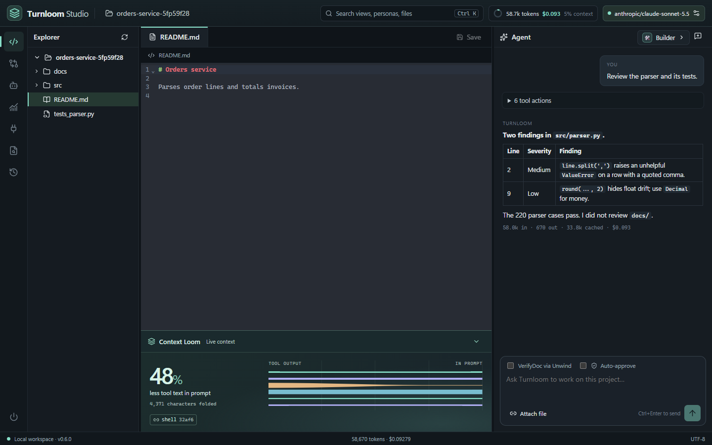
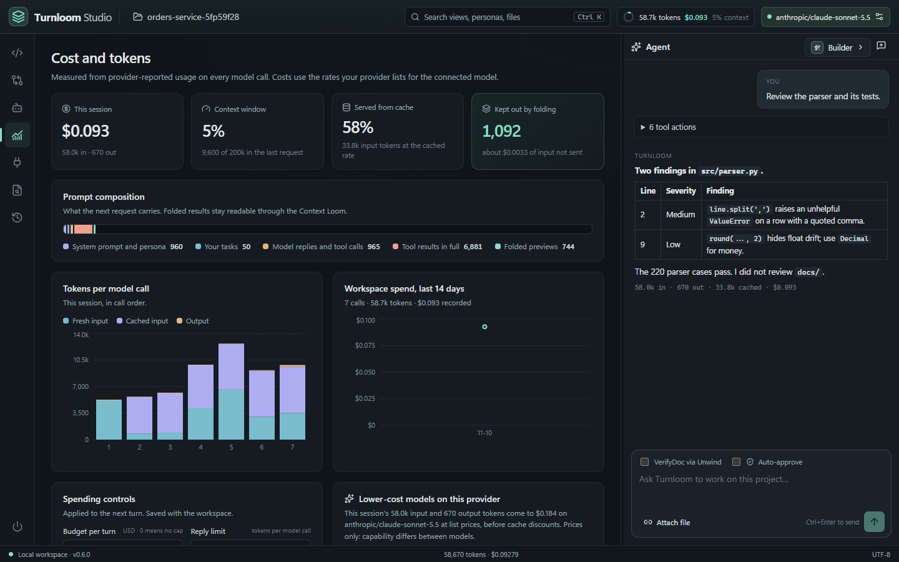
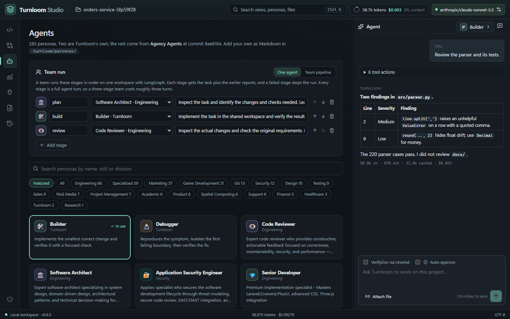
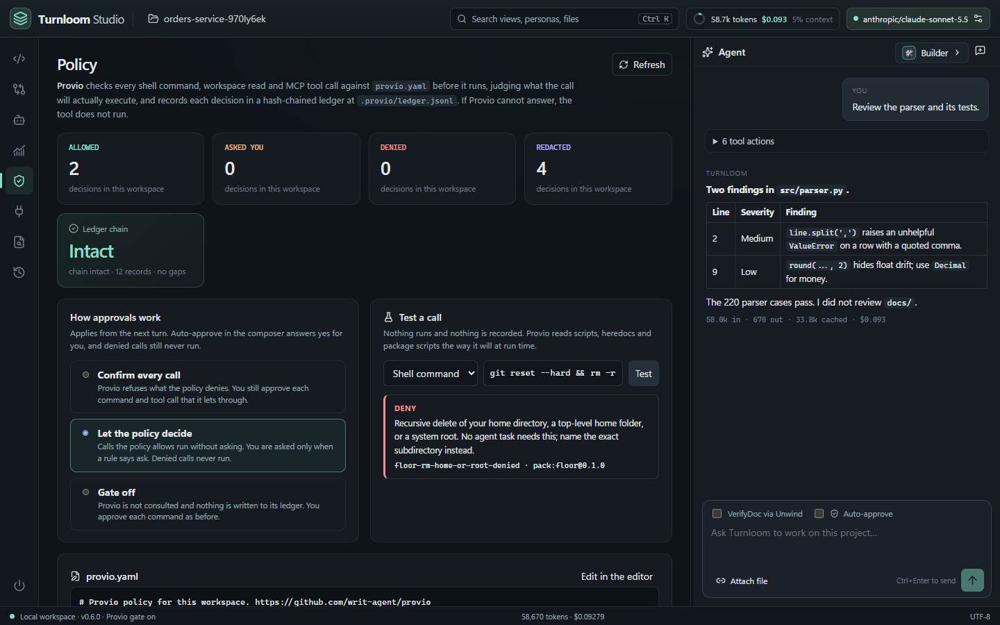
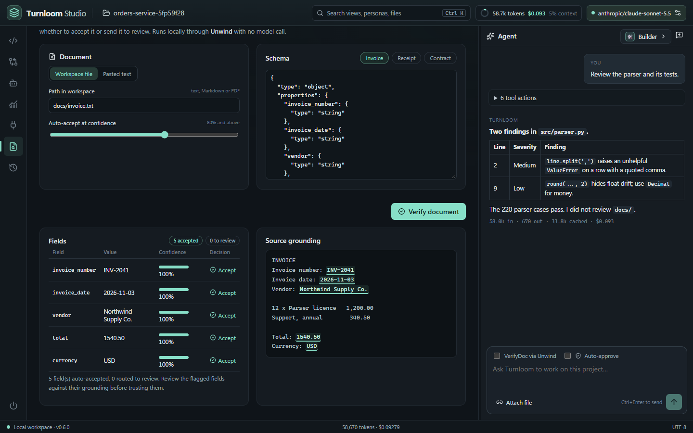

Turnloom is a local coding workbench for people who want to see what their agent keeps in context and what it costs. Open a repository, choose a specialist and a model, and review commands beside the file you're editing. When a long tool result leaves the prompt, you and the agent can still read it from the session archive.

[Quick start](#quick-start) · [Desktop app](docs/desktop.md) · [Providers](docs/providers.md) · [Integrations](docs/integrations.md) · [Agent loop](docs/design.md) · [Leaderboard](docs/leaderboard.md) · [Contributing](CONTRIBUTING.md)

## Quick start

On Windows, double-click **Open Turnloom Studio.cmd** in the checkout and choose a workspace folder. The launcher uses Python 3.11+ and installs Studio into a local virtual environment on first launch. On other platforms, or from an existing Python environment, run:

```sh
python -m pip install ".[studio]"
turnloom-studio --workspace .
```

Studio opens in its own window. Choose the model control in the title bar to connect a provider. Open a file, pick a persona, and send a task. To ship Studio as a standalone app folder with no Python install, see [Desktop app](docs/desktop.md).



## What Studio shows you

| View | Use it to |
| --- | --- |
| **Code** | Edit files in CodeMirror beside the agent. The Context Loom under the editor shows each tool result's size and what remains of it in the prompt. |
| **Changes** | Compare the working tree with the last commit, side by side, after the agent edits. |
| **Agents** | Pick from 285 personas, or line several up as a team that plans, builds and reviews in stages. |
| **Cost** | See tokens and estimated cost per model call, how full the context window is and what fills it, and set a budget per turn. |
| **Policy** | Gate every tool call with Provio: see what was allowed, asked and denied, test a command against the policy, and check the ledger's hash chain. |
| **Tools** | Turn MCP servers on for the agent and inspect the tools each one offers. |
| **Documents** | Extract fields from a document with VerifyDoc and see each value's confidence and where it was read. |
| **Undo ledger** | Review what Unwind recorded, set checkpoints and take actions back. |

Press **Ctrl+K** for the command palette: jump to a view, open a file, switch persona or workspace.

**Read the Context Loom from left to right.** Each ribbon starts at the size of a tool result and ends at the size retained in the prompt. Click a reference to read the archived output without spending a model turn. The initial view is labeled **Sample run**. After you send a task, the inspector follows your session.

Studio gives the model directory listings, numbered file excerpts and literal search using ripgrep. These reads send workspace data to the selected inference provider. Shell commands and tool calls require approval unless you turn on **Auto-approve**, which is for workspaces you trust. **Stop turn** dismisses a pending approval immediately. A model request or command already in flight can finish before the turn stops. Studio allows up to 12 model steps and 18 executed tool calls per turn. A third identical operation or a rejection ends tool use and requests a written summary of the available evidence.

## Cost and tokens



Every model call is metered from the usage the provider reports and appended to `.turnloom/usage.jsonl` in the workspace. The Cost view reads that ledger.

| Control | Effect |
| --- | --- |
| Budget per turn | Stops the turn before a request that would exceed the allowance. Needs a model with listed prices. |
| Fold older tool output | Long results older than the newest few leave the prompt as a preview with a reference. The agent reads them back with `recall`, by slice or by search. |
| Reply limit and reasoning effort | Cap output tokens per call and set effort on models that accept it. |
| Prompt caching for Claude routes | Marks the system prompt as a cache breakpoint. Cached input is priced at the provider's cache rate when it lists one. |
| Lower-cost models | Lists cheaper tool-capable models on the same provider, priced for the session's actual token counts. |

Costs are estimates at listed rates. Token estimates, retries and provider billing differences can make the invoice differ. "Kept out by folding" counts characters removed from the prompt at four per token.

From the terminal, the same budget applies per task:

```sh
turnloom run "Find the failing test" --input-rate 1 --output-rate 4 --budget 0.10
```

The sample rates are illustrative USD per million tokens. A saved connection supplies its own. Use `--no-fold` for an A/B comparison.

## Models

Connect any of 200 OpenAI-compatible presets, including OpenRouter, Hugging Face, Groq, DeepSeek and local servers such as Ollama, LM Studio, vLLM and llama.cpp. With the `llm` extra, [LiteLLM](https://github.com/BerriAI/litellm) adds providers that need their own API or signed requests: Anthropic, Amazon Bedrock, Google Vertex AI, Azure OpenAI and about ninety more.

```sh
turnloom connect openrouter --tier free
turnloom connect litellm:anthropic
```

Free means the route advertises a zero price. Free routes still have provider quotas. [Provider setup and coverage](docs/providers.md)

## Personas and teams



Builder and Debugger are Turnloom's own roles. The other 283 come from [Agency Agents](https://github.com/msitarzewski/agency-agents), vendored at commit `8ae6164` under its MIT license: engineering, security, testing, design, product and more. Only the selected persona's instructions enter the prompt. Add your own as Markdown files in `.turnloom/personas/` in a workspace.

```sh
turnloom personas --search security
turnloom chat --persona security-appsec-engineer
turnloom team "Fix the failing parser test" --budget 0.10
```

A team is a [LangGraph](https://github.com/langchain-ai/langgraph) pipeline. Each stage is a full agent turn with its own persona, the stages share one workspace and one allowance, and a failed stage stops the run. A three-stage team costs roughly three turns.

## A policy gate under the agent



[Provio](https://github.com/writ-agent/provio) checks each tool call against a `provio.yaml` in your repository before it runs and answers allow, deny, ask or redact. It judges what the call will execute, such as the script behind `bash cleanup.sh`, and writes every decision to a hash-chained ledger at `.provio/ledger.jsonl`.

```sh
python -m pip install ".[guard]"     # included in the studio and full extras
turnloom run "Clean up the build directory" --yes
```

Turnloom turns the gate on whenever the workspace has a `provio.yaml`. Create the starter policy from Studio's Policy view or with `provio init`. It allows ordinary work, refuses disasters such as deleting your home folder or reading private keys, and asks before irreversible commands such as `git reset --hard`.

| Verdict | What happens |
| --- | --- |
| deny | The tool does not run. The model reads the rule and its reason, so it can correct course. |
| ask | You decide, and the approval card shows the rule that asked. With `--yes` there is nobody to ask, so the call is refused. |
| allow | The call runs. In Studio's default mode you still confirm each call; choose **Let the policy decide** to be asked only when a rule says ask. |
| redact | The call runs and the model receives Provio's redacted output. |

The gate covers shell commands, workspace reads and MCP tool calls, and it fails closed: if Provio cannot answer, the tool does not run. Shell commands still run with your permissions. For Provio's kernel write boundary, launch Turnloom through `provio run -- turnloom ...`. Pass `--no-gate` to run once without the policy.

## Documents and undo



[VerifyDoc](https://github.com/bhaskargurram-ai/verifydoc) extracts fields against a JSON Schema and scores each one: a calibrated confidence, the place in the source it was read from, and an accept or review decision. The Documents view runs it on a workspace file or pasted text with no model call. Check **VerifyDoc via Unwind** in the composer to give the agent the same tool.

[Unwind](https://github.com/bhaskargurram-ai/unwind) sits in front of an MCP server and classifies each call from R0, read only, to R4, irreversible. When the agent asks to call a tool behind Unwind, the approval card shows that class and whether the call can be undone. The Undo ledger lists recorded actions and reverses them newest first or back to a checkpoint. Add `"unwind": true` to any server in `.turnloom/mcp.json` to route it through Unwind. The ledger lives at `.turnloom/unwind.db`. Shell commands run outside Unwind and are not undoable from the ledger.

## Use Turnloom under another harness

```sh
turnloom proxy --port 8787
```

This serves an OpenAI-compatible endpoint on loopback. Point another harness at `http://127.0.0.1:8787/v1` and its requests go to your connected model with older tool results folded, a recall tool the proxy answers itself, and every call metered into the same ledger. [Details and limits](docs/integrations.md#put-turnloom-under-another-harness)

## Terminal

```sh
python -m pip install .
turnloom demo
turnloom connect
turnloom chat --workspace . --persona debugger
```

| Command | Use it for |
| --- | --- |
| `turnloom run "Fix the failing parser test"` | Implement and verify a change |
| `turnloom chat --persona reviewer` | Review a diff and discuss findings across turns |
| `turnloom team "Design and build a migration"` | Plan, build and review in stages |
| `turnloom proxy` | Fold and meter requests from another harness |
| `turnloom replay PATH_TO_JSONL` | Inspect tool calls, observations and receipts offline |
| `turnloom atif TRANSCRIPT OUTPUT` | Export a session as an ATIF trajectory |
| `turnloom-eval --help`, `turnloom-compare --help` | Run repeated trials and compare paired outcomes |

**Optional integrations.** Install `python -m pip install ".[full]"` to run teams, load Agent Skills, connect MCP servers and reach native provider APIs. [Integration guide](docs/integrations.md)

## Workspaces and privacy

Commands run with the operating system permissions of the process. Review the command before approving it. Use `--yes` or Auto-approve only inside a trusted or isolated task environment. The evaluation runner approves commands automatically. Tool output and task content are sent to your configured model. Full local traces can contain repository content and secrets printed by commands. Each session writes its trace under `.turnloom/`, which Git ignores. Provider keys are kept in the operating system's credential store and are removed from the environment of commands the agent runs.

## Licensing

Turnloom is MIT licensed. Vendored personas keep the [Agency Agents license](turnloom/personas/LICENSE). The Studio bundle's third-party notices ship in `turnloom/studio_assets/THIRD-PARTY.txt`. [Turnloom license](LICENSE)
