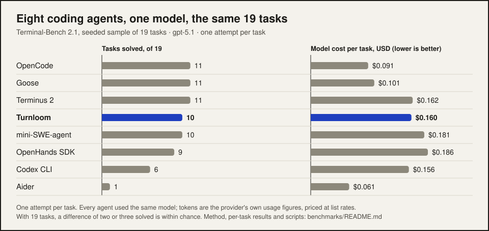

# Benchmarks

Turnloom and seven other coding agents were given the same Terminal-Bench 2.1 tasks, the same model and one attempt per task, with every model call metered the same way. This page has the results, the method, the limits of the comparison and the scripts to run it again.

**The short version.** On 19 tasks Turnloom solved 10. The best agents solved 11, and with this few tasks a difference of one is chance. Turnloom was not the cheapest: it cost 0.160 USD per task, against 0.091 for OpenCode and 0.101 for Goose. The comparison was run by Turnloom's author, on one machine, on 18 and 19 November 2026.



## Results

Round one: 19 tasks, OpenAI `gpt-5.1`, one attempt per task. Turnloom ran at commit `68b697b`, which is version 0.7.0 with two fixes described under [What the run changed in Turnloom](#what-the-run-changed-in-turnloom).

| Agent | Version | Solved | 95% interval | Cost per task | Cost per solved task | Input tokens per task (cached) | Output tokens per task | Model calls per task | Median agent time |
| --- | --- | --- | --- | --- | --- | --- | --- | --- | --- |
| OpenCode | 1.19.6 | 11 of 19 | 36% to 77% | $0.091 | $0.158 | 110,562 (94,619) | 6,060 | 9.3 | 112 s |
| Goose | 1.60.1 | 11 of 19 | 36% to 77% | $0.101 | $0.175 | 180,595 (159,360) | 5,470 | 11.7 | 77 s |
| Terminus 2 | 2.0.0 | 11 of 19 | 36% to 77% | $0.162 | $0.280 | 51,228 (37,592) | 14,056 | 6.1 | 128 s |
| **Turnloom** | `68b697b` | 10 of 19 | 32% to 73% | $0.160 | $0.304 | 70,192 (47,892) | 12,637 | 13.5 | 100 s |
| mini-SWE-agent | 2.4.6 | 10 of 19 | 32% to 73% | $0.181 | $0.343 | 134,693 (120,522) | 14,796 | 13.0 | 162 s |
| OpenHands SDK | 1.62.0 | 9 of 19 | 27% to 68% | $0.186 | $0.394 | 326,500 (299,082) | 11,477 | 11.4 | 142 s |
| Codex CLI | 0.170.0 | 6 of 19 | 15% to 54% | $0.156 | $0.495 | 275,188 (251,203) | 9,483 | 13.8 | 93 s |
| Aider | 0.86.2 | 1 of 19 | 1% to 25% | $0.061 | $1.163 | 3,626 (694) | 5,745 | 1.2 | 87 s |

Rows are ordered by tasks solved, then by cost per task. The interval is the 95% Wilson score interval for the pass rate. Turnloom's call count includes one request per task that the API refused: it asks for a reply limit as `max_tokens` first and switches when the endpoint wants `max_completion_tokens`.

### What the numbers say

- **Six agents cannot be told apart on tasks solved.** OpenCode, Goose, Terminus 2, Turnloom, mini-SWE-agent and OpenHands SDK solved between 9 and 11 of 19, and their intervals overlap almost completely. This run does not show that any of them is better at solving tasks than another.
- **Turnloom sends less input than most.** It sent 70,192 input tokens per task. Terminus 2 sent fewer; the other five agents that work through a tool loop sent between 1.6 and 4.7 times as many. This is the effect of folding old tool output out of the prompt.
- **That did not make Turnloom cheap.** Output tokens cost eight times as much as uncached input, and Turnloom produced 12,637 of them per task, of which 79% were reasoning tokens. Output was 0.126 USD of Turnloom's 0.160 USD per task. Goose and OpenCode produced about half as many.
- **A likely reason is the API, not the loop.** Leaving Aider aside, the four agents with the fewest output tokens (Goose, OpenCode, Codex CLI and OpenHands SDK) call the Responses API, which carries the model's reasoning from one call to the next. Turnloom, mini-SWE-agent and Terminus 2 call Chat Completions, which does not, and all three produced 12,000 to 15,000 output tokens per task. This run did not test that explanation. Moving Turnloom to the Responses API is [on the roadmap](https://github.com/bhaskargurram-ai/turnloom/issues/15).
- **Folding costs cache hits.** 68% of Turnloom's input was served from the provider's cache, the lowest share among the tool-loop agents; the others ranged from 73% to 92%. Rewriting earlier messages invalidates the cached prefix. At these prices the loss is small: all of Turnloom's input cost 0.034 USD per task.
- **Aider's row is not a fair picture of Aider.** Harbor runs it as a single message with no command execution, so it can only solve a task that one round of file edits completes.

### Task by task

| Task | OpenCode | Goose | Terminus 2 | Turnloom | mini-SWE-agent | OpenHands SDK | Codex CLI | Aider | Solved by |
| --- | --- | --- | --- | --- | --- | --- | --- | --- | --- |
| `regex-log` | pass | pass | pass | pass | pass | pass | pass | pass | 8 of 8 |
| `multi-source-data-merger` | pass | pass | pass | pass | pass | pass | pass | fail | 7 of 8 |
| `openssl-selfsigned-cert` | pass | pass | pass | pass | pass | pass | pass | fail | 7 of 8 |
| `prove-plus-comm` | pass | pass | pass | pass | pass | pass | pass | fail | 7 of 8 |
| `build-pmars` | pass | pass | pass | pass | pass | time limit | pass | fail | 6 of 8 |
| `git-leak-recovery` | pass | pass | pass | pass | pass | fail | pass | fail | 6 of 8 |
| `hf-model-inference` | pass | pass | pass | pass | pass | pass | fail | fail | 6 of 8 |
| `pytorch-model-recovery` | pass | pass | pass | pass | pass | pass | time limit | fail | 6 of 8 |
| `nginx-request-logging` | pass | pass | pass | fail | pass | pass | fail | fail | 5 of 8 |
| `sqlite-db-truncate` | pass | fail | pass | fail | fail | pass | fail | fail | 3 of 8 |
| `log-summary-date-ranges` | fail | fail | fail | pass | pass | fail | fail | fail | 2 of 8 |
| `polyglot-rust-c` | pass | pass | time limit | time limit | time limit | fail | fail | fail | 2 of 8 |
| `pypi-server` | fail | fail | pass | fail | fail | pass | fail | fail | 2 of 8 |
| `sanitize-git-repo` | fail | pass | fail | pass | fail | fail | fail | fail | 2 of 8 |
| `configure-git-webserver` | fail | fail | fail | fail | fail | fail | fail | fail | 0 of 8 |
| `db-wal-recovery` | fail | fail | fail | fail | time limit | time limit | fail | fail | 0 of 8 |
| `kv-store-grpc` | fail | fail | fail | fail | fail | fail | fail | fail | 0 of 8 |
| `largest-eigenval` | fail | fail | time limit | time limit | fail | fail | fail | fail | 0 of 8 |
| `model-extraction-relu-logits` | fail | fail | fail | fail | fail | fail | fail | fail | 0 of 8 |

"Time limit" means the agent was still working when the task's own limit ended it. Eight tasks were solved by six or more agents and five by none, so the six tasks in between do nearly all of the separating.

## Second round

Round one showed two things to fix in Turnloom. To check the fixed version on tasks it had not been tuned on, the next tasks in the same seeded order were run for all eight agents, with Turnloom at commit `6344940`, the code released as 0.7.1.

Eight tasks were planned. The machine ran out of memory during the sixth, and the run stopped there. One of the five finished tasks, `query-optimize`, is left out because three agents could not be installed inside the time limit while Docker was restarting. That leaves four tasks.

| Agent | Version | Solved | Cost per task | Input tokens per task (cached) | Output tokens per task | Median agent time |
| --- | --- | --- | --- | --- | --- | --- |
| Aider | 0.86.2 | 2 of 4 | $0.096 | 6,468 (1,888) | 9,170 | 67 s |
| Goose | 1.60.1 | 2 of 4 | $0.103 | 83,380 (70,976) | 7,830 | 97 s |
| Codex CLI | 0.170.0 | 2 of 4 | $0.147 | 140,270 (114,816) | 10,093 | 134 s |
| OpenHands SDK | 1.62.0 | 2 of 4 | $0.151 | 176,324 (154,624) | 10,488 | 137 s |
| **Turnloom** | `6344940` | 2 of 4 | $0.293 | 90,443 (56,704) | 24,418 | 446 s |
| mini-SWE-agent | 2.4.6 | 2 of 4 | $0.335 | 485,202 (450,912) | 23,576 | 399 s |
| Terminus 2 | 2.0.0 | 1 of 4 | $0.173 | 105,459 (92,384) | 14,477 | 202 s |
| OpenCode | 1.19.6 | 0 of 4 | $0.142 | 145,879 (123,264) | 9,950 | 173 s |

| Task | Aider | Goose | Codex CLI | OpenHands SDK | Turnloom | mini-SWE-agent | Terminus 2 | OpenCode | Solved by |
| --- | --- | --- | --- | --- | --- | --- | --- | --- | --- |
| `extract-elf` | pass | pass | pass | pass | pass | pass | error | fail | 6 of 8 |
| `polyglot-c-py` | pass | pass | pass | fail | pass | pass | pass | fail | 6 of 8 |
| `chess-best-move` | fail | fail | fail | pass | fail | fail | time limit | fail | 1 of 8 |
| `raman-fitting` | fail | fail | fail | fail | fail | fail | fail | fail | 0 of 8 |

Four tasks are too few to rank anything, and too few to show whether the fixes helped. Two things are still worth recording. Turnloom solved the same two tasks most agents solved. And Turnloom and mini-SWE-agent worked far longer than the others on `chess-best-move` and `polyglot-c-py`, which is why they cost about twice as much here: Turnloom spent 12 minutes on `chess-best-move` and still gave a wrong answer. Terminus 2's `extract-elf` trial failed in Harbor before its first model call, so that cell is a harness error and not a judgement of the agent.

## Method

**Tasks.** [Terminal-Bench 2.1](https://github.com/harbor-framework/terminal-bench-2-1) at commit `d49e28f`, the commit the public harness leaderboard pins. Of its 89 tasks, 47 have an agent time limit of 15 minutes or less and need 4 GB of memory or less. Those 47 were put in a fixed order with `random.Random(0).sample`. Nothing was chosen by hand; `run.py --list` prints the order. Round one is the first 20 in that order and the second round continues from the 21st.

**Runner.** [Harbor](https://github.com/harbor-framework/harbor) 0.24.0 with its Docker environment, on one Windows 11 machine with Docker Desktop, six trials at a time. Each trial is one attempt at one task under the task's own time limit, checked by the task's own verifier. Every agent's install time limit was multiplied by four, because the installs shared one machine and one network connection.

**Model.** OpenAI `gpt-5.1` for every agent. A request that stated no reasoning effort was given `medium`, and `temperature` and `top_p` were removed from it, because the API refuses them alongside a reasoning effort. A request that stated an effort was left alone. In the recorded calls, OpenHands SDK asked for `high`, its own default, and every other agent's calls ran at `medium`. OpenCode also made one small call per task to `gpt-5.4-nano` to name its session; that call is counted in its cost. Aider made one call to `gpt-5-nano` in the second round, which the meter has no price for; it would add less than a tenth of a cent.

**Agents.** Seven agents that Harbor ships an adapter for and that run on an OpenAI key, each installed by Harbor at the version current on the day and run with its defaults, plus Turnloom through [`integrations/harbor/turnloom_harbor.py`](../integrations/harbor/turnloom_harbor.py). Turnloom was told the model's context window and reply limit, because it has no table of its own; the other agents look them up. Claude Code, Gemini CLI and Cursor's agent are not here because they need their own providers' models.

**Metering.** [`meter.py`](meter.py) sits between every agent and the provider. Token counts are the provider's own usage figures for each call, not each agent's bookkeeping, and cost is those tokens at list price: 1.25 USD per million input tokens, 0.125 cached, 10 output. The real API key stays in the meter; agents are given a throwaway token. The meter retries the provider's rate-limit and server errors before an agent sees them, so a score does not depend on how busy the shared key was. It changes nothing else in a request, and its docstring lists exactly what it does change.

**Limits on spending.** A trial was cut off at 2.50 USD of model spend, and the whole exercise at 35 USD. No reported trial reached its limit. Everything, including a pilot and the trials lost to interruptions, cost 29.80 USD; the trials reported here account for 26.66 USD of that.

## What the run changed in Turnloom

The comparison was also a test of Turnloom, and it found three problems.

1. **Every model call was sent twice.** Behind a gateway, `gpt-5.1` refuses `max_tokens` and asks for `max_completion_tokens`. Turnloom retried correctly but did not remember, so each call started with a refused request. Found in a pilot on the first two tasks and fixed before round one.
2. **A bare refusal for paths outside the workspace.** The file tools reach only the project folder, and the error did not say that the shell was the tool for other paths, so the model retried or guessed. Found in the same pilot and fixed before round one.
3. **Instructions instead of actions.** On `nginx-request-logging` and `pypi-server` in round one, Turnloom ended by telling a reader which commands to run. Nobody reads the reply of a headless run. `turnloom-agent` now tells the model the session is unattended. Fixed after round one, so round one's numbers include this failure.

The pilot's two tasks, `multi-source-data-merger` and `openssl-selfsigned-cert`, are part of round one. Seven of the eight agents solved both, so they do not separate Turnloom from the others. All three fixes are in [0.7.1](../CHANGELOG.md).

## Limits of this comparison

- **Small samples.** Nineteen tasks, then four. The intervals in the first table are the honest size of the uncertainty.
- **One attempt per task.** Agents and models vary from run to run. A task marked "fail" might pass on a second attempt, and the reverse.
- **One model.** Results on `gpt-5.1` say little about another model, and nothing about agents that only run on their own providers' models.
- **A subset of the benchmark.** Only tasks with a time limit of 15 minutes or less and 4 GB of memory or less were eligible, which leaves out the longest and heaviest tasks. These numbers are not Terminal-Bench scores and cannot be compared with a leaderboard.
- **Run by Turnloom's author.** Every agent ran with its defaults through the adapter Harbor ships, and nothing was tuned for or against any of them, but nobody independent has repeated the run. The scripts and the per-call records are here so that someone can.
- **Tasks left out.** `qemu-alpine-ssh` from round one, because no agent could be installed in its image: the image's package index no longer serves the packages the installers need. `query-optimize` from the second round, as described above.
- **Interruptions.** The machine went to sleep during round one, and Docker stopped responding at the start of the second round. Trials in progress at those moments were discarded and run again from the start. Their model calls are not in the costs above.
- **Different effort for one agent.** OpenHands SDK ran at reasoning effort `high` because that is its default; the others ran at `medium`.

## Run it yourself

You need Docker, Python 3.12 or later, an OpenAI API key, and a checkout of this repository and of the tasks.

```sh
python -m pip install harbor==0.24.0 aiohttp
git clone https://github.com/harbor-framework/terminal-bench-2-1
git -C terminal-bench-2-1 checkout d49e28f
```

Start the meter in one terminal. It reads the real key from `OPENAI_API_KEY`; the token is any string you make up, and it is all the agents ever see.

```sh
python benchmarks/meter.py --token throwaway-123 --budget 35 --trial-budget 2.5 --effort medium --ledger usage.jsonl
```

Run the trials in another terminal, then join the results with the meter's records and make the table and the figure:

```sh
python benchmarks/run.py --tasks terminal-bench-2-1/tasks --out runs --token throwaway-123 \
    --adapters integrations/harbor --count 20 --concurrent 6 --turnloom v0.7.1
python benchmarks/collect.py --out runs --ledger usage.jsonl --json results.json
python benchmarks/report.py results.json --markdown results.md --grid tasks.md --svg results.svg
```

`run.py --list` prints the task order without running anything, `--skip 20` continues with the tasks after the first twenty, and `--agents turnloom goose` runs a subset. A pair of agent and task that already has a result is skipped, so an interrupted run can be resumed with the same command. Round one took about four hours on a 32 GB machine.

## Files

| File | What it is |
| --- | --- |
| [`meter.py`](meter.py) | The pass-through that meters every model call and holds the API key |
| [`run.py`](run.py) | Runs one Harbor job per agent and task |
| [`collect.py`](collect.py) | Joins Harbor's results with the meter's records |
| [`report.py`](report.py) | Makes the tables and the figure |
| [`results/round-one.json`](results/round-one.json), [`results/second-round.json`](results/second-round.json) | One row per agent and task: outcome, error, time, tokens and cost |
| [`results/round-one-calls.jsonl`](results/round-one-calls.jsonl), [`results/second-round-calls.jsonl`](results/second-round-calls.jsonl) | One line per model call, as the meter recorded it. No prompts or replies |

Found a mistake, or ran it and got different numbers? [Open an issue](https://github.com/bhaskargurram-ai/turnloom/issues/new/choose) or [start a discussion](https://github.com/bhaskargurram-ai/turnloom/discussions).
