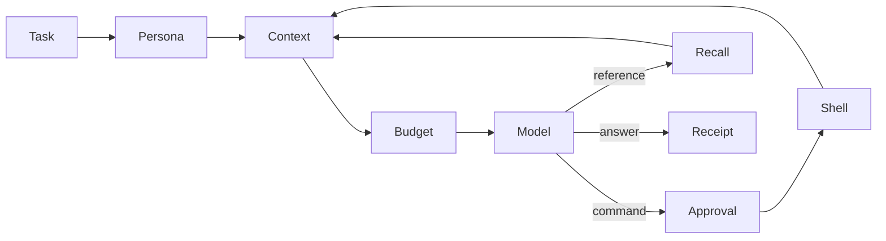

# Agent loop

The CLI owns the conversation, selected persona, transcript path and in-memory observation store. The agent module owns the model protocol and tool loop. Each model call targets the configured endpoint and model. There is no background specialist inference.

Tool output is clipped at capture before entering history. The context store indexes returned observations by a content digest, keeps up to two million characters, and evicts older entries first. Recall reads the captured observation from that session. A subsequent command executes against the current workspace. At context pressure the agent removes old complete exchanges and preserves the original task and newest user instruction. Large individual requests may still exceed a provider's actual tokenizer limit.

Each completed call records its usage and cumulative cost. A transcript is an append-only JSONL file. Replay renders it without running commands. Replay is available after process exit. Interactive history and observation lookup live for the current chat.
