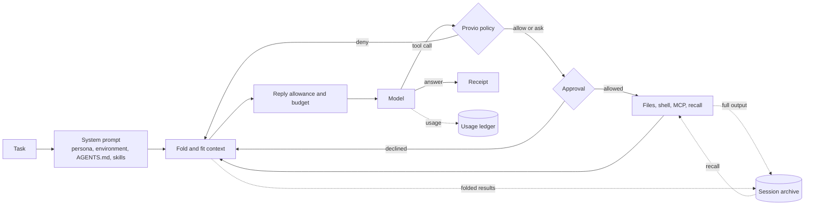

# Design

Turnloom is one loop in `turnloom/agent.py`, a context store in `turnloom/context.py`, and file tools in `turnloom/tools.py`. The terminal (`cli.py`), Studio (`studio.py`), the MCP server (`server.py`), the headless entry point (`turnloom-agent`) and the evaluation runner (`evaluate.py`) all drive that same loop through a `Config`.

## One step

Each step runs in this order:

1. **Stop checks.** The operator's stop flag, the deadline and the step limit.
2. **Fold.** Tool results older than the newest three and of 4,000 characters or more are replaced by a preview and a reference. The preview keeps the first 180 and last 120 characters, the length, and a note saying how to read the rest. Results that arrived after the latest assistant message are never folded, so a batch of parallel calls reaches the model whole. Smaller results stay: folding a short file saves a few hundred tokens and costs far more when the model, no longer able to see it, reads it again. For the same reason a result that was folded and then fetched again is left whole, and of several copies it is the newest that stays.
3. **Fit.** The prompt is estimated at four characters per token, scaled by the ratio the provider reported on the previous call. If it exceeds the window, the oldest complete exchange is saved to the archive as one record and removed; its reference is appended to the system message and the transcript records a `context` event. The system prompt, the first task and the newest user message always stay. If only the newest exchange remains and it is still too large, its biggest tool result is archived and shortened in place.
4. **Reply allowance.** The reply limit is set to what remains of the window after the prompt, with a 20% margin on the estimate, so a provider that refuses input plus reply beyond its window still gets a request that fits.
5. **Budget.** With a budget set, the next request is priced from the estimate. The reply limit shrinks to what the remaining allowance affords, or the turn stops with `budget_limit`.
6. **Request.** One POST to `/chat/completions`. With a text callback the request streams and tool-call fragments are assembled by index. An endpoint that rejects streaming options is remembered and asked for whole replies. Retries cover 408, 409, 425, 429, 500, 502, 503, 504 and 529 with backoff that honors `Retry-After`; a reply that has started to appear is never replayed, and a timed-out request is retried once. Endpoints of the form `litellm://provider` go through LiteLLM instead and return whole replies. On OpenRouter and LiteLLM routes to Claude models the system prompt is marked as a cache breakpoint.
7. **Reply.** A reply without tool calls is the answer. Tool calls run one at a time, each through the policy gate when one is active and then the approval gate.

## Tools

| Tool | Approval | Notes |
| --- | --- | --- |
| `list_files`, `read_file`, `search_files` | none | Confined to the workspace. `search_files` uses ripgrep when installed and a built-in scanner otherwise. |
| `edit_file`, `write_file` | yes, with a diff | `edit_file` replaces one exact match. If the text differs only by indentation or trailing space and matches one place, it is applied with the file's indentation. Line endings are preserved. Writes are atomic. |
| `shell` | yes | `cmd.exe` on Windows, `/bin/sh` elsewhere. A timeout or a stop ends the whole process tree. |
| `recall` | none | Reads a slice of an archived record, or up to five matches of a search string with their surroundings. |
| `mcp_search`, `mcp_call` | calls only | Present when MCP servers are configured. |

Every path is resolved before use. Paths that leave the workspace through `..`, an absolute path, a drive, a symlink or a Windows alternate data stream are refused. `.git`, `.turnloom`, virtual environments, `node_modules`, `.ssh`, `.aws` and `.gnupg` are closed to everyone. Files whose names look like secrets (`.env`, `*.pem`, `id_rsa*`, `.npmrc` and similar) are closed to the model's file tools and open to the operator's editor in Studio.

A read-only session offers the model only the read tools and `recall`: no edits, no shell and no MCP tools. Its system prompt says so. The standard prompt describes the edit and shell tools and asks for the smallest change that solves the task; given that prompt with no means to act, a model reads the same files until it runs out of calls. A session that switches between acting and read-only from one turn to the next has the opening of its prompt switched with it.

When the model asks to read, list, search or recall something and the result is identical to one still in the conversation in full, it gets a one-line note saying so in place of the same text again. Commands are not treated this way: running a test twice and getting the same output is information.

When the model gives its final answer and the last command it ran exited with an error or timed out, the loop does not accept the answer at once. It adds one message naming the command and how it failed, and the model either carries on or answers again, saying that the command still fails and why. This happens at most once in a turn, and a command that succeeds afterwards clears it. The message is recorded in the transcript as a `check` event, so a resumed session has it too.

External programs Turnloom starts itself (ripgrep, Git, Provio, a browser) are looked up on `PATH` and in the interpreter's scripts folder, never in the current directory or the workspace, so a repository cannot supply its own `rg.cmd` or `git.cmd`.

## Approval and policy

`agent.permitted` is the approval gate: it asks the caller's `approve(kind, detail)` callback, where `kind` is `shell`, `edit` or `mcp`. With no callback, an action runs only if the caller set `auto_approve`. Nothing is approved by omission.

When a workspace has a `provio.yaml` and the `guard` extra is installed, `agent.gated` first hands the call to Provio as `bash`, `fs.read`, `fs.write` or the MCP tool's name. A denial returns the rule and its reason to the model. An ask verdict goes to the operator with the rule shown, or is refused when nobody can answer. An allowed call continues to the approval gate unless the operator chose to let the policy decide. If Provio cannot answer, the tool does not run. The policy judges a file by its resolved location. A search asks the policy about each file that matched and returns only lines from files it allows; a file whose rule says ask is left out, and the model can request it by name. When a rule asks about an edit, the operator sees the diff in that one prompt.

## The archive

`Observations` maps a 16-character content digest to text and holds up to four million characters, evicting the least recently used record first. A reference is deterministic, so rebuilding a session from its transcript produces the same references.

Three things enter the archive: a tool result when it is folded, the complete output of a command when the prompt only received its head and tail (up to 400,000 characters per stream), and an exchange removed to fit the window. A folded message keeps pointing at the fullest record that exists for it.

## Guards

- Three identical tool calls in a row end tool use. The model is asked once more, without tools, to write up the evidence gathered, and the turn ends as `partial`.
- At the step limit the last call is spent the same way.
- Studio also caps tool calls per turn and ends tool use when the operator declines an action.
- An interrupted turn can leave tool calls without results. They are removed before the next request so the conversation stays valid.

## Transcript and usage

Each session appends to `<workspace>/.turnloom/<id>.jsonl`. Every event carries a timestamp. Events are `start` (task, model, system prompt; later stages of a team run are marked `continues`), `assistant` (message and usage), `tool` (result), `edit` (path with content before and after), `context` (exchanges archived to fit the window) and `end` (the receipt). The folder gets a `.gitignore` covering traces, the usage ledger and the undo database; `mcp.json` and `personas/` stay visible to Git.

The transcript is the durable form of a session. `replay` prints it, `--resume` rebuilds the conversation from it, `undo` restores files from its `edit` events, `turnloom atif` converts it to an ATIF trajectory, and `turnloom serve` reads it for other agents. It contains file contents and command output, so treat it like the code it came from.

Studio and the proxy also append one line per model call to `.turnloom/usage.jsonl`: model, persona, tokens, cached tokens, estimated cost and the tokens folding kept out. The Cost view reads that ledger.

## Receipt

`Result` carries the status, the answer, steps, elapsed time, token usage, estimated cost at the configured rates, folded characters and the files changed. Cached prompt tokens are priced at the connection's cache rate when one is known. When a provider omits usage, the call is metered by estimate and the receipt says so.
