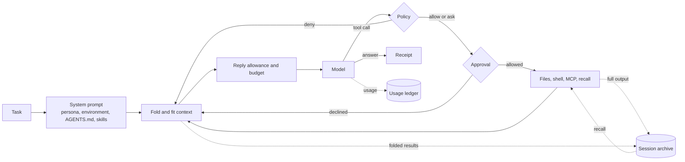
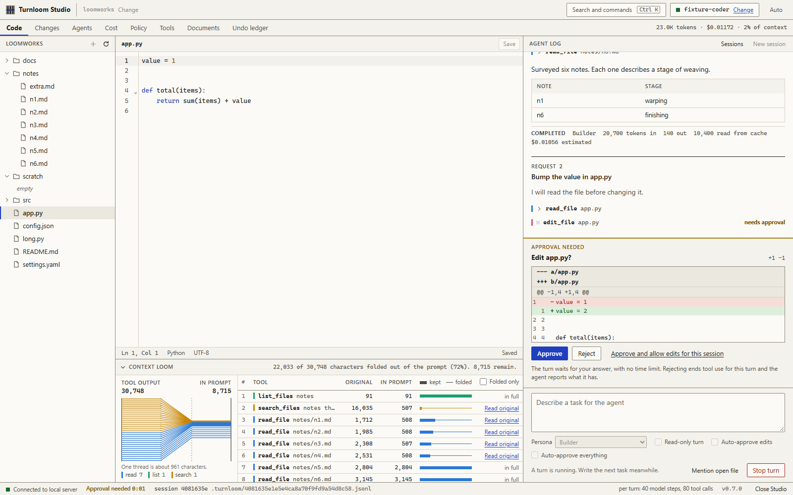
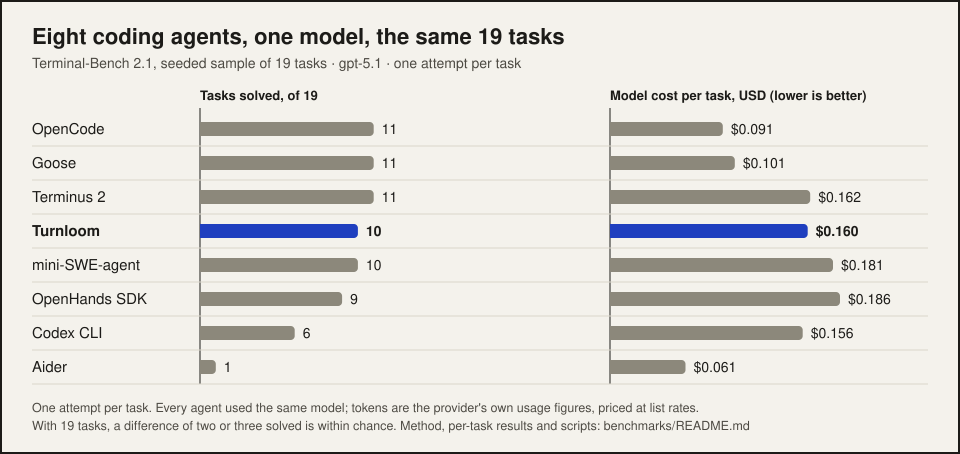
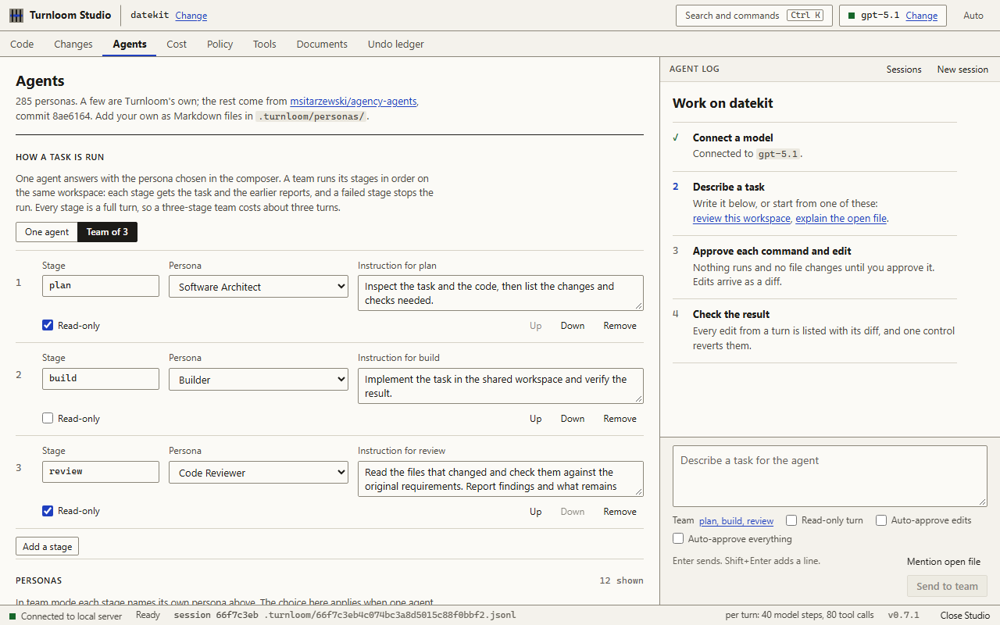

# Recoverable Context for Coding Agents

**A technical report on Turnloom 0.7.2**

Bhaskar Gurram · 20 November 2026 · [github.com/bhaskargurram-ai/turnloom](https://github.com/bhaskargurram-ai/turnloom)

## Abstract

A coding agent fills its prompt with tool output: files it read, searches it ran, test logs it waited for. Long sessions outgrow the model's context window, and the common answer, summarizing the conversation with another model call, throws away detail that the model and the developer may need again. Turnloom is a small open-source coding agent built around a different answer. Older tool output is folded out of the prompt and replaced by a short preview and a reference; the full text stays in a local archive that the model can read back with a `recall` tool and the developer can open in a web UI. Nothing leaves the prompt without a way back, and no model call is spent on summaries.

This report describes that design and the parts built around it: approval of every command and edit, a policy gate, a staged team of agents, and metering of every model call. It then reports what was measured. On 19 Terminal-Bench 2.1 tasks with `gpt-5.1`, Turnloom solved 10, against 11 for the best of seven other agents, a difference within chance at that sample size. It sent fewer input tokens than five of the six other agents that work through a tool loop, but it was not the cheapest, because it produced about twice the output tokens of the two cheapest agents. The report also covers three defects found by running Turnloom on its own work, how they were fixed, and the limits of every number given here.

## 1. The problem

An agent loop is simple: send the conversation to the model, run the tool calls it returns, append the results, repeat. The results are the problem. A single file read can be thousands of tokens, a test run tens of thousands, and every one of them is resent on every later call. A session that reads twenty files and runs the tests a few times reaches the limit of a 128,000-token window well before the task is done, and pays for the same text many times on the way.

Agents handle this in three ways.

- **Truncate.** Drop the oldest messages. Cheap and predictable, but whatever was dropped is gone, including the instructions and observations the rest of the session depends on.
- **Summarize.** Ask the model to compress the conversation into a summary and continue from that. This keeps the gist but loses the detail, costs a model call, and gives the developer no way to see what was kept. It also fails in ways that are hard to notice. In a keyword search of the public issue trackers of five widely used coding agents on 20 November 2026, we found 56 issues about compaction filed since 1 October. Most report a failure: compaction lost the active task, dropped current instructions, mangled the conversation, looped, or failed outright. The rest ask for more control over it, such as a way to undo it. The count is informal: the issues were found by searching for words such as "compaction" and read only far enough to confirm they were on topic.
- **Fold and keep.** Remove old output from the prompt but keep it, addressable, outside the prompt. This is Turnloom's approach.

The goal is not only a smaller prompt. A developer who hands work to an agent should be able to answer two questions at any moment: *what did the model see?* and *what did it cost?* Most agents make both hard to answer. Turnloom is built so that both have exact answers.

## 2. Design principles

1. **Nothing is discarded without a way back.** Anything removed from the prompt is archived under a reference, and both the model and the developer can read it again.
2. **The developer decides.** Every command, edit and external tool call waits for approval, as a diff where there is one. Edits can be undone, including from a later session.
3. **Every call is measured.** Each model call's tokens, cached tokens and estimated cost are recorded, and every turn ends with a receipt.
4. **Small enough to read.** The loop, the context store and the file tools are about 1,700 lines of Python. The core depends on the standard library and one package, `keyring`. Everything else is an optional extra.
5. **Any model.** Turnloom speaks the OpenAI-compatible chat API, so it works with hosted providers, routers and local servers such as Ollama, LM Studio, vLLM and llama.cpp.

## 3. Architecture

One loop drives every interface: the terminal commands, the local web UI (Studio), the MCP server, the headless entry point used for benchmarks, and the GitHub Action. Each builds a `Config` and calls the same `run_agent`.

*Figure 1. One step of the loop. Dotted lines carry data that leaves the prompt but stays available.*

Each step does the following, in order.

1. **Stop checks:** the operator's stop flag, the deadline and the step limit.
2. **Fold** old tool output (section 4).
3. **Fit** the prompt into the window. The prompt is estimated at four characters per token, scaled by the ratio the provider reported on the previous call. If it is still too large, the oldest complete exchange is archived as one record and removed, and its reference is appended to the system message. The system prompt, the first task and the newest user message always stay.
4. **Reply allowance.** The reply limit is set to what remains of the window, with a 20% margin on the estimate.
5. **Budget.** With a budget set, the next request is priced in advance; the reply limit shrinks to what the remaining allowance affords, or the turn stops.
6. **Request,** streamed when possible, with retries and backoff for rate limits and server errors.
7. **Reply.** A reply without tool calls is the answer. Tool calls run one at a time, each through the policy gate and then the approval gate.

## 4. Recoverable context

### 4.1 Folding

Before each request, tool results older than the newest three and of 4,000 characters or more are replaced in the prompt by a preview: the first 180 and last 120 characters, the full length, a reference, and a note that says how to read the rest. The note is written so that a model never told about folding still sees that text is missing and how to get it.

Two cases are never folded:

- **Results the model has not read yet.** Anything after the latest assistant message stays whole, so a batch of parallel calls reaches the model complete.
- **Results the model fetched again.** If a folded result is read a second time, the new copy stays whole. Folding it again would only make the model fetch it a third time. Of several copies, the newest stays.

The 4,000-character threshold is new in 0.7.2; it was 800 before. Folding a 1,500-character file saves a few hundred tokens and costs far more if the model, no longer able to see it, reads it again. Section 7.3 describes the run that exposed this.

### 4.2 The archive and recall

The archive maps a 16-character content digest to text and holds up to four million characters, evicting the least recently used record first. Because references are content digests, rebuilding a session from its transcript produces the same references, so a resumed session can still recall what an earlier process folded.

Three things enter the archive: a tool result when it is folded; the complete output of a command when the prompt received only its head and tail (up to 400,000 characters per stream); and an exchange removed to fit the window. The model reads any of them with `recall`, either as a slice by offset and length or as the lines around a search string.

### 4.3 Seeing what the model saw

Studio's Context Loom shows every tool result of the session as a thread: its original size, the size it has in the prompt now, and whether it is folded. Any folded original opens with one click. The session transcript on disk always holds every result in full, and the same data is available to other agents through Turnloom's MCP server.

*Figure 2. Studio during a turn. The Context Loom (bottom) shows 30,748 characters of tool output reduced to 8,715 in the prompt, with each folded original one click away.*

### 4.4 Repeated reads

When the model asks to read, list, search or recall something and the result is identical to one still in the conversation in full, it gets a one-line note saying so instead of the same text again. Commands are deliberately excluded: running a test twice and getting the same output is information.

### 4.5 The cost of folding

Folding rewrites earlier messages, and that invalidates the provider's prompt cache from the first rewritten message onward. In the benchmark (section 6), 68% of Turnloom's input tokens were served from cache, the lowest share among the tool-loop agents, whose shares ranged from 73% to 92%. At `gpt-5.1` prices the loss was small: all of Turnloom's input cost 0.034 USD per task. It is a real trade-off nonetheless, and the right threshold depends on the provider's cache pricing.

## 5. Keeping the developer in control

### 5.1 Approval

Every shell command, file edit and MCP tool call goes through one gate, which asks the interface's approval callback. With no callback, an action runs only if the caller explicitly chose to approve everything. Nothing is approved by omission. Edits are shown as diffs, written atomically, and recorded with their content before and after, so `turnloom undo` can restore them from any later session.

### 5.2 Policy

An optional policy file, enforced by the Provio policy engine, sits in front of the approval gate. It allows, denies or asks about commands, reads, writes and MCP tools by rule. A denial returns the rule and its reason to the model. An "ask" verdict always reaches the operator, even when an earlier "always allow" would have covered the call, and is refused when nobody can answer. If the policy engine cannot answer, the tool does not run.

### 5.3 Confinement

Every path goes through one resolver. Paths that leave the workspace through `..`, an absolute path, a drive letter, a symbolic link or a Windows alternate data stream are refused. Version-control internals, virtual environments, `node_modules`, `.ssh`, `.aws` and `.gnupg` are closed to everyone, and files whose names look like secrets are closed to the model. Commands inherit the operator's environment with model credentials removed. This is a guard against accidents, not a sandbox; a sandbox for approved commands is on the roadmap.

### 5.4 Read-only sessions

A read-only session offers the model only the read tools and `recall`, and since 0.7.2 its system prompt says so. Section 7.3 explains why that sentence matters.

### 5.5 Answers after a failed command

When the model gives its final answer and the last command it ran exited with an error or timed out, the loop does not accept the answer at once. It adds one message naming the command and how it failed. The model either carries on or answers again, saying plainly that the command still fails and why that is acceptable. This happens at most once in a turn, and a later command that succeeds clears it. Section 7.4 reports what it did in practice.

## 6. Measurement

### 6.1 Receipts and the usage ledger

Every turn ends with a receipt: status, steps, elapsed time, input, cached and output tokens, characters folded, files changed and estimated cost. Cached tokens are priced at the connection's cache rate when it is known. Studio and the folding proxy also append one line per model call to a usage ledger, which the Cost view charts. When a provider omits usage, the call is metered by estimate and the receipt says so.

### 6.2 Comparison with seven other agents

Turnloom and seven other coding agents were run on the same tasks, with the same model and one attempt per task, with every model call metered by the same proxy.

- **Tasks:** Terminal-Bench 2.1 at commit `d49e28f`. Of its 89 tasks, the 47 with an agent time limit of 15 minutes or less and 4 GB of memory or less were put in a fixed order with a seeded random sample; round one is the first 19 usable tasks.
- **Runner:** Harbor 0.24.0 with Docker, each agent at its defaults through the adapter Harbor ships, and Turnloom through its own adapter.
- **Model:** OpenAI `gpt-5.1` at reasoning effort `medium` (OpenHands SDK asked for `high`, its own default).
- **Metering:** a proxy between every agent and the provider recorded the provider's own token counts for every call, priced at list price.

| Agent | Solved (of 19) | 95% interval | Cost per task | Input tokens per task | Cached share | Output tokens per task |
| --- | --- | --- | --- | --- | --- | --- |
| OpenCode | 11 | 36%–77% | $0.091 | 110,562 | 86% | 6,060 |
| Goose | 11 | 36%–77% | $0.101 | 180,595 | 88% | 5,470 |
| Terminus 2 | 11 | 36%–77% | $0.162 | 51,228 | 73% | 14,056 |
| **Turnloom** | **10** | 32%–73% | **$0.160** | **70,192** | **68%** | **12,637** |
| mini-SWE-agent | 10 | 32%–73% | $0.181 | 134,693 | 89% | 14,796 |
| OpenHands SDK | 9 | 27%–68% | $0.186 | 326,500 | 92% | 11,477 |
| Codex CLI | 6 | 15%–54% | $0.156 | 275,188 | 91% | 9,483 |
| Aider | 1 | 1%–25% | $0.061 | 3,626 | 19% | 5,745 |

*Table 1. Round one. The interval is the 95% Wilson score interval for the pass rate. Aider's row is not representative: Harbor runs it as a single message with no command execution.*

*Figure 3. Tasks solved and cost per task, round one.*

What the results show:

- **No ranking on tasks solved.** Six agents solved between 9 and 11 of 19, and their intervals overlap almost completely.
- **Folding reduces input.** Turnloom sent 70,192 input tokens per task. Of the other tool-loop agents, only Terminus 2 sent fewer; the rest sent 1.6 to 4.7 times as many.
- **Less input did not mean lower cost.** Output tokens cost eight times as much as uncached input, and output was 0.126 USD of Turnloom's 0.160 USD per task. Turnloom produced about twice the output tokens of Goose and OpenCode, 79% of them reasoning tokens.
- **A plausible cause is the API.** Leaving Aider aside, the four agents with the fewest output tokens call OpenAI's Responses API, which carries the model's reasoning from one call to the next. Turnloom, mini-SWE-agent and Terminus 2 call Chat Completions and all produced 12,000 to 15,000 output tokens per task. Section 7.2 tests this.

A second round of four further tasks, run after the first fixes, was too small to rank anything: Turnloom and five other agents each solved two of the four. The full results, every per-call record and the scripts to repeat the run are published with the code.

## 7. What running Turnloom on real work changed

### 7.1 Three defects found by the benchmark

1. **Every model call was sent twice.** Behind a gateway, `gpt-5.1` refuses `max_tokens` and asks for `max_completion_tokens`. Turnloom retried correctly but did not remember, so every call began with a refused request.
2. **A bare refusal for paths outside the workspace.** The error did not say that the shell was the tool for other paths, so the model retried or guessed.
3. **Advice instead of action.** In an unattended run, Turnloom sometimes ended by telling a reader which commands to type. Nobody reads the reply of a headless run; the headless entry point now tells the model the session is unattended.

All three were fixed in 0.7.1.

### 7.2 An optional Responses API transport

To test the explanation in section 6.2, 0.7.2 adds an optional transport that speaks OpenAI's Responses API. It sends requests with `store: false`, receives the model's reasoning as encrypted items, keeps those items with the assistant message they came with, and sends them back in order on later calls. Folding and window fitting drop an item together with its message, and a call is never sent without its result. Chat Completions remains the default for every provider.

The measurements disagree, and both are reported here.

| Measurement | Runs | Chat output tokens (mean) | Responses output tokens (mean) | Tests fixed |
| --- | --- | --- | --- | --- |
| Three small bug-fix projects, paired | 10 pairs | 1,636 | 862 (−47%) | all runs |
| One harder project, three bugs | 2 pairs | 5,690 and 2,911 | 3,160 and 3,569 | all runs |
| One small bug-fix project, on the final 0.7.2 code | 4 pairs | 4,422 | 4,512 | 4 of 4 each |

*Table 2. Responses transport against Chat Completions, `gpt-5.1`, reasoning effort `medium`.*

On the first set of small tasks the Responses transport used fewer output tokens in all ten pairs, and its cost, priced with cached input at the cached rate, was 25% lower. An ablation with reasoning replay switched off reduced the saving on one project and not on another, so carried reasoning explains only part of it. On the harder project and on the final code there was no saving. The transport is therefore offered as an option to measure on one's own tasks, not as a cost reduction.

### 7.3 A planner that could not plan

Turnloom can run a task as a team: a sequence of stages, each a full turn with its own persona and instructions, sharing one workspace. Studio's default team has three stages: *plan* (Software Architect, read-only), *build* (Builder) and *review* (Code Reviewer, read-only). Any stage can use any of 285 personas: Turnloom's own and a vendored set from the agency-agents project.

Recording a demonstration of this feature on a five-file Python project exposed a defect. Asked to add a function with tests, the plan stage used its full allowance of 40 model calls reading the same five files over and over, more than 200,000 input tokens, and the team stopped without building anything.

The first suspicion was folding: at the old 800-character threshold, each small file was folded soon after it was read. Raising the threshold to 4,000 characters and keeping re-fetched results whole changed nothing; the second run also used 40 calls, with the files fully in view. The trace showed the real cause. A read-only stage received the standard system prompt, which describes the edit and shell tools and asks for "the smallest change that fully solves the task". Told to make a change and given no tool to make it with, the model kept reading.

A read-only session now gets its own system prompt, which says that it can only read and that finishing means answering. On the same task the team then completed all three stages in **9 model calls, 26,217 input tokens and 3,973 output tokens, about 0.06 USD** at list price. It changed three files and all nine tests passed. The two context changes were kept as well, since each removes a way to waste calls, but the prompt was the fix.

*Figure 4. The Agents view: a three-stage team. Plan and review are read-only.*

### 7.4 Answers that claimed success too early

In six runs of one bug-fix task at the model's default reasoning effort, the check described in section 5.5 fired three times: in one run the model went on and fixed the bug, one run ended as partial, and one still reported success with the test failing. Four of the six runs fixed the bug. At reasoning effort `medium` the check never fired in eight runs, and all eight fixed the bug. The check is cheap and catches some false claims of success. It is not a guarantee, and the report says so.

## 8. Running agents on the project itself

Turnloom runs on its own repository. Three GitHub workflows use it: a review of each pull request, triage of each new issue (labels and a comment naming the code involved), and an attempt at an issue on a separate branch when a maintainer adds a label. They currently run on a free model through OpenRouter.

An agent in CI reads text written by strangers, so the workflows assume that text can talk the model into anything and limit what that can reach.

- The job that holds the model key cannot write to the repository and cannot run commands.
- A separate job posts the result and never talks to the model. It removes mentions, markup and outside links from the answer and applies only labels from a fixed list.
- A pull request's code is never checked out for review; the change reaches the agent as a diff.
- An attempt's edits are executed only by a job that holds no secret and can only read. The code that runs is never the code the agent edited: the action is installed from an untouched checkout, and Python starts with the working directory off its import path.
- Edits under `.github/` are never pushed, and every change reaches the main branch only through a pull request a person opens.

These rules are checked by the test suite against the workflow files, so a change that breaks one fails the build.

## 9. Limitations

- **Small samples.** The comparison used 19 tasks, then four, with one attempt each. The intervals in Table 1 are the honest size of the uncertainty, and the transport measurements in Table 2 are smaller still.
- **One model.** Every number here comes from `gpt-5.1`. Other models, especially smaller local ones, may behave differently, and folding should matter more with small windows. That has not been measured.
- **One author.** The comparison was run by Turnloom's author. Every agent ran at its defaults through the adapter its harness ships, but nobody independent has repeated the run. The scripts and per-call records are published so that someone can.
- **Not a sandbox.** Approval and path confinement prevent accidents. They do not contain a malicious command that the operator approves.
- **Folding and caching pull in opposite directions.** Rewriting earlier messages lowers cache hits. The threshold is a judgment, not an optimum.

## 10. Future work

- A sandbox for approved commands, so that unattended runs are safe outside a container.
- Native transports for the Anthropic Messages API, and continued measurement of the Responses transport on harder tasks.
- Sign-in support in the editor protocol (ACP), needed to appear in editors' agent registries.
- A full Terminal-Bench 2.1 run with three attempts per task, ideally by someone other than the author.

## 11. Availability

Turnloom is MIT licensed and installs with `pip install turnloom`. The source, the documentation, the benchmark scripts and every per-call record are at [github.com/bhaskargurram-ai/turnloom](https://github.com/bhaskargurram-ai/turnloom). The design is documented in [docs/design.md](design.md), the comparison in [benchmarks/README.md](../benchmarks/README.md), and the CI workflows in [docs/automation.md](automation.md). Corrections and independent measurements are welcome as issues or pull requests.
